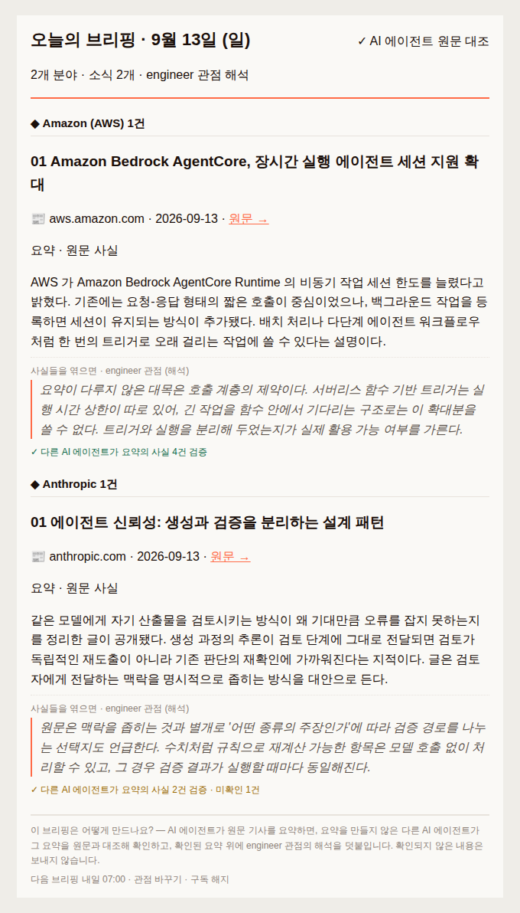

# Agent-Claude-Code-With-Codex

**검증 후 발행(verify-before-publish) AI 뉴스 브리핑 에이전트** — 두 개의 코딩 하니스(**Claude Code** 가 작성,
**Codex** 가 검증)를 Amazon Bedrock 위에서 함께 돌려, *발행 전에 독립 검증된* 개인화 모닝 브리핑을 매일 이메일로 보냅니다.

기사를 **쓰지** 않습니다. 요약하고, **검증하고**, 검증을 통과한 것만 보냅니다.

---

## 문제 — AI 요약을 믿을 수 있나

AI 요약의 문제는 틀린다는 게 아니라 **틀린 걸 알 수 없다**는 겁니다. 읽는 사람이 원문을 다시 읽어야 한다면
요약은 시간을 아껴주지 못합니다.

흔한 해법은 "모델에게 자기 요약을 검토시키기"인데, 이건 생각보다 잘 듣지 않습니다. 같은 모델이 같은 맥락에서
검토하면 **생성할 때의 오해가 검토할 때도 그대로 남습니다** — 독립적인 재도출이 아니라 자기 판단의 재확인이
되기 때문입니다. 오류가 상관(correlated)되어 있으면 검토를 두 번 해도 같은 곳에서 같이 틀립니다.

이 프로젝트는 그 상관을 **구조적으로 끊는 것**으로 문제를 풉니다.

## 핵심: 검증 후 발행 게이트

**결정론 파이썬 코드(gate)가 오케스트레이터**이고, 두 LLM 하니스는 그 밑에서 **서로를 볼 수 없는 상태로**
각각 작성과 검증을 맡습니다.

```
                   ┌──────── gate (결정론 파이썬) ────────┐
                   │   발행/차단 결정을 소유 — LLM 아님    │
                   └───────────────┬──────────────────────┘
         ┌─────────────────────────┴─────────────────────────┐
         ▼                                                   ▼
┌──────────────────────┐     ╔═══════════╗     ┌──────────────────────┐
│ 작성자 `claude -p`    │     ║  차단벽    ║     │ 인증자 `codex exec`   │
│ 원문 + 관점 + 개인화  │     ║           ║     │ envelope 4필드만      │
│ → 요약 + 원자적 주장  │     ║ 추론 누설 ║     │ → 주장별 판정         │
│                      │     ║    0      ║     │ 작성자 추론 · 관점 ·   │
│ 다른 모델 계열        │     ╚═══════════╝     │ 사용자 = 전부 못 봄    │
└──────────────────────┘                       └──────────────────────┘
```

- **작성자(Claude Code)** 는 원문을 사용자의 **관점(lens)** 으로 요약하고, 요약이 진술한 모든 사실을
  **원자적 주장(atomic claim)** 으로 뽑습니다.
- **인증자(Codex)** 는 주장 하나하나를 원문과 대조합니다. 받는 건 화이트리스트 **4필드**뿐 —
  원문 구절 · 주장 문장 · 주장 유형 · 출력 스키마. **작성자의 추론은 물론 관점·사용자·다른 주장도 못 봅니다.**
- **결정은 코드가 합니다.** 통과하면 발행(PUBLISH), 막히면 격리(QUARANTINE). 검증되지 않은 사실은
  발행되지 않습니다(fail-closed).

두 가지가 동시에 지켜져야 "확인 도장"이 아닌 진짜 독립 재도출이 됩니다 — ⓐ **다른 모델 계열**,
ⓑ **작성자의 추론 차단**. 그래서 두 하니스는 각각 **빈 작업 디렉토리에서 별도 프로세스로** 실행합니다
(저장소의 `CLAUDE.md`·`AGENTS.md` 가 자동 로드되면 그것만으로 상관이 조용히 되살아납니다).

> **한 가지 정직한 이야기.** 실제 차단 기록을 감사해보니 BLOCK 47건 중 **46건이 파이썬 산술 검증,
> 1건만 Codex** 였습니다. 숫자가 들어간 주장은 LLM 이 아니라 **결정론 코드**가 판정하기 때문입니다 —
> 무료고, 재현 가능하고, 실행할 때마다 같은 답이 나옵니다. 신뢰의 무게중심은 "AI 두 개"가 아니라
> **결정론 게이트**에 있습니다.

## 받아보는 것



메일 한 통의 구조:

| 요소 | 의미 |
|---|---|
| `✓ AI 에이전트 원문 대조` | 헤더 인장 — 이 메일의 사실은 발행 전에 대조됐다 |
| `◆ Amazon (AWS) 1건` | **분야 밴드** — 발행처 기준 그룹(분야가 2개 이상일 때만) |
| `요약 · 원문 사실` | **사실층** — 검증 대상. 제목은 기사 원제목 그대로(재프레이밍 안 함) |
| `사실들을 엮으면 · engineer 관점` | **해석층** — 관점이 붙는 곳. 요약이 담지 않은 것만, 새 사실 금지 |
| `✓ 다른 AI 에이전트가 요약의 사실 4건 검증` | 검증줄. **미확인 N · 제외 K** 도 숨기지 않고 함께 표시 |

**고를 수 있는 것:** 출처(13개 vetted 카탈로그 · 뉴스·미디어/Amazon/Anthropic/Google/커뮤니티) ·
**관점** 5종(`general` `engineer` `business` `researcher` `agent-builder`) ·
밀도 3단(`title-only` `summary` `full`) · 발송 시각(사용자 타임존 기준).

관점은 **강조와 어휘만** 바꿉니다 — 사실은 못 바꿉니다. 인증자가 관점을 아예 안 보기 때문에 구조적으로
그렇습니다. 메일 UX 스펙: [`design/ux/email-ux-mockup.md`](design/ux/email-ux-mockup.md).

## 동작 방식

```
 수집   RSS · HTML 추출 · 피드 자동발견        ← 출처는 카탈로그로 고정(임의 URL 금지)
   │    소스 하나가 실패해도 나머지는 진행
   ▼
 필터   AI 무관 기사 컷(종합지 피드) → 캡 초과분 선별   ← 요약·검증 *전* 에 잘라 비용 절감
   │
   ▼
 동결   sha256(정규화 원문) = source_id       ★ 작성자도 인증자도 *같은 바이트*를 본다
   │                                            (작성자가 자기 증거를 통제하지 못하게)
   ▼
 사실층  작성자 → 요약 + 원자적 주장
   │         ↓
   │      인증자 → 주장별 판정      숫자 포함 → 결정론 파이썬(LLM 없음)
   │         ↓                      그 외    → codex exec
   │      막힌 주장 있으면 재도출(최대 2회, 피드백 = 실패한 주장 번호뿐)
   │         ↓
   │      PUBLISH · 또는 QUARANTINE
   ▼
 해석층  검증된 사실 위에 관점 한 단락 — 결정론 lint 통과 시에만
   │         (새 사실·수치 밀수 차단. 실패하면 해석만 버리고 카드는 산다)
   ▼
 발송   검증 발행분이 1건 이상일 때만 SES 로 전송
```

두 층으로 나눈 건 경제학 때문입니다. **사실층은 관점·개인화와 무관해 전 사용자가 한 장을 공유**하고,
관점별 해석만 따로 만듭니다. 비싼 검증이 사용자 수와 무관해집니다.

더 깊이: [`design/architecture/system-map.md`](design/architecture/system-map.md) — 배포 지형부터 신뢰 경계까지 7장의 그림.

## 직접 돌려보기

```bash
uv sync                                        # 의존성

uv run pytest                                  # 테스트(전부 결정론 — AWS·LLM 불필요)
uv run ruff check src tests                    # 린트

uv run python -m briefing.local.run            # AWS 없이 로딩·동결 확인 (무지출)
DEBUG=1 uv run python -m briefing.local.run    # + 파이프라인 디버그 추적(stderr)
```

실제 두 하니스를 태우는 end-to-end (⚠️ **Bedrock 과금**, `claude`·`codex` CLI 와 AWS 자격증명 필요):

```bash
DEBUG=1 uv run python scripts/e2e_smoke.py     # 실 RSS → 작성 → 검증 → 렌더
```

`DEBUG=1` 은 추적을 **stderr** 로 냅니다(stdout 의 이메일·JSON 을 오염시키지 않게). 인증자에게 건너가는
envelope, 게이트의 PUBLISH/QUARANTINE 결정, 두 CLI 의 종료 코드가 보입니다.

## 저장소 구조

```
src/briefing/
├── core/           # 도메인(호스트 무관) — 여기가 진실
│   ├── gate.py         # ★ 검증 후 발행 오케스트레이터 (결정론)
│   ├── pipeline.py     # 수집 → 사실층 → 해석층 → 렌더 드라이버
│   ├── authoring/      # 작성자 = claude -p
│   ├── verification/   # 인증자 = codex exec + 결정론 산술 검증
│   ├── retrieval/      # 출처 카탈로그 · 수집 · 관련성/선별 필터
│   ├── stores/         # 동결 원문 · 카드 캐시 · 발행 원장 (local ↔ DynamoDB)
│   └── render.py       # 검증 명세서 이메일
├── runtime/        # ② AgentCore 어댑터 + 컨테이너 빌드 자산
├── scheduler/      # ⑤ 발송 체인 (due → dispatch → SES)
├── webapi/         # ④ 웹 백엔드 (FastAPI + Lambda)
├── gateway/        # ① Gateway(MCP) 어댑터 — 기본 off
└── local/          # AWS 없는 베이스라인
web/                # ④ 프론트엔드 (Vite + React → CloudFront)
infra/              # CloudFormation + 배포 단위 인덱스
design/             # 설계 문서 — PRD · 리서치 · 아키텍처 · UX
docs/               # 실행 산출물 — 스펙 · 플랜 · 전달 기록
```

## AWS 배포 (us-east-1)

다섯 개 단위로 나뉩니다. 상세와 재현 절차는 [`infra/README.md`](infra/README.md).

| | 단위 | 내용 |
|---|---|---|
| ② | **Runtime** | AgentCore — 컨테이너에 두 하니스(`claude` + `codex`)를 함께 번들. 렌더·큐레이션·관점 변경은 컨테이너에 구워지므로 **재배포해야 라이브** |
| ③ | **DB** | DynamoDB — 동결 원문 · 카드 캐시 · 발행 원장 · 사용자 |
| ⑤ | **Scheduler** | EventBridge(시간당 1회) → Lambda(즉시 반환) → Runtime 비동기(≤8h) → SES. 규칙은 **1개**, 누가 발송 대상인지는 순수 함수가 타임존별로 계산 |
| ④ | **Web UI** | S3 + CloudFront(SPA) + HTTP API. 체험 발송과 구독(Cognito) |
| ① | **Gateway** | 수집 3도구를 AgentCore Gateway(MCP)로 승격. **기본 off** — 화이트리스트가 3개라 게이트·인증자로 가는 경로가 아예 없습니다 |

`.env` 가 통합 버스입니다. 재배포 전에 `SES_SENDER` 등 키가 비어 있지 않은지 확인하세요 — 비면 발송이
조용히 실패합니다.

## 현황과 한계

정직하게 적습니다.

- **외부 이메일 발송은 제한적입니다.** 소유 도메인 + SES DKIM 이 있어야 깨끗하게 나갑니다.
  현재는 검증된 주소로 데모하는 구성이고, 공용 메일 도메인에서 발신하면 DMARC 에 막힙니다.
- **조용한 실패를 알려주지 않습니다.** 카드 하나가 타임아웃으로 드롭되면 로그에는 남지만 **통지가 없습니다.**
  극단적으로 밀집한 논문(수식 다수)은 어떤 타임아웃 값으로도 못 막아서 드롭됩니다 — 통지 구현이 남은 일입니다.
- **진짜 차단된 출처는 수집하지 않습니다.** Cloudflare 챌린지나 JS 전용 페이지는 미구현입니다
  (접근통제 우회는 선을 넘는다고 보고 보류). 평문 HTML 로 잡히는 출처만 다룹니다.
- **해석층은 인증자를 거치지 않습니다.** 대신 결정론 lint 네 가지가 그 자리를 대신합니다(근거 인용 검사,
  미검증 수치 밀수 차단 등). 카드에 검증 배지가 붙는 만큼 이 비대칭은 의도적으로 좁혀 두었습니다.
- **① Gateway 는 v1 에서 필수 경로가 아닙니다.** 배포·검증은 끝났지만 기본은 off 이고, 실질적 가치는
  다음 버전에서 나옵니다.

## 더 읽기

| 문서 | 내용 |
|---|---|
| [`design/architecture/system-map.md`](design/architecture/system-map.md) | **시스템 전경** — 7장의 그림으로 배포 지형·제어 흐름·신뢰 경계 |
| [`design/architecture/pipeline-flow.md`](design/architecture/pipeline-flow.md) | 카드 한 장이 만들어지는 흐름 (클로즈업) |
| [`design/`](design/) | PRD · 외부 리서치 · 아키텍처 분석 · 메일 UX 스펙 |
| [`docs/README.md`](docs/README.md) | 기능별 스펙·플랜·전달 기록 색인 (무엇이 언제 배포됐나) |
| [`CLAUDE.md`](CLAUDE.md) | 개발 가이드 — 아키텍처 규칙 · 하니스 격리 · 범위 제약 |

## 개발 규칙

- **하니스 격리는 비협상입니다.** headless `claude -p` 와 `codex exec` 는 반드시 **빈 작업 디렉토리**에서
  실행합니다. 저장소 루트에서 실행하면 `CLAUDE.md`/`AGENTS.md` 가 자동 로드돼 인증자가 프로젝트 맥락을
  알게 되고, 그 순간 아무 에러 없이 상관이 되살아납니다. (그래서 이 저장소에는 `AGENTS.md` 를 두지 않습니다.)
- **비가역 조치는 코드가 소유합니다.** 발행·발송 결정은 LLM 이 아니라 게이트가 합니다.
- **언어:** 문서·docstring·주석은 **한국어 우선**, 코드(식별자·API·CLI 플래그·로그)는 이식성을 위해 **영어**.
  정확한 영어 기술 용어는 이중 언어로 — 예: 검증 후 발행(verify-before-publish).
